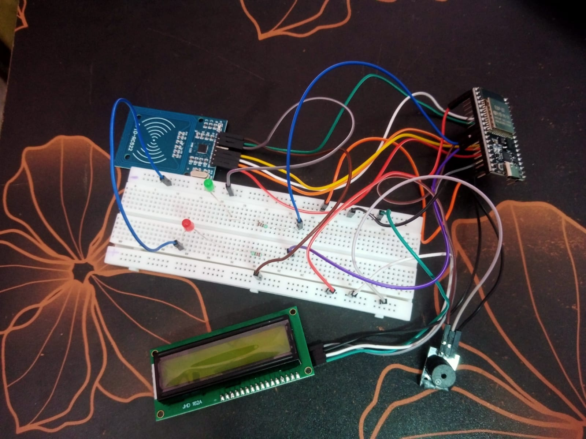
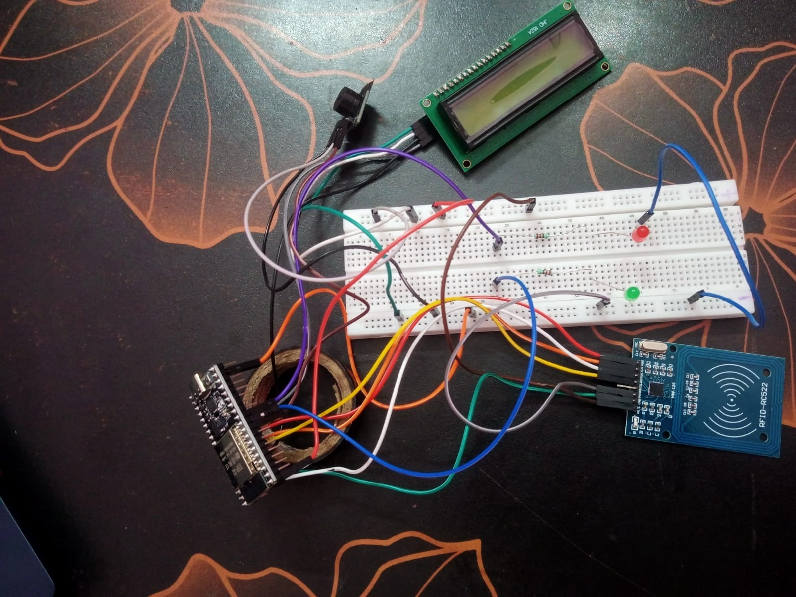
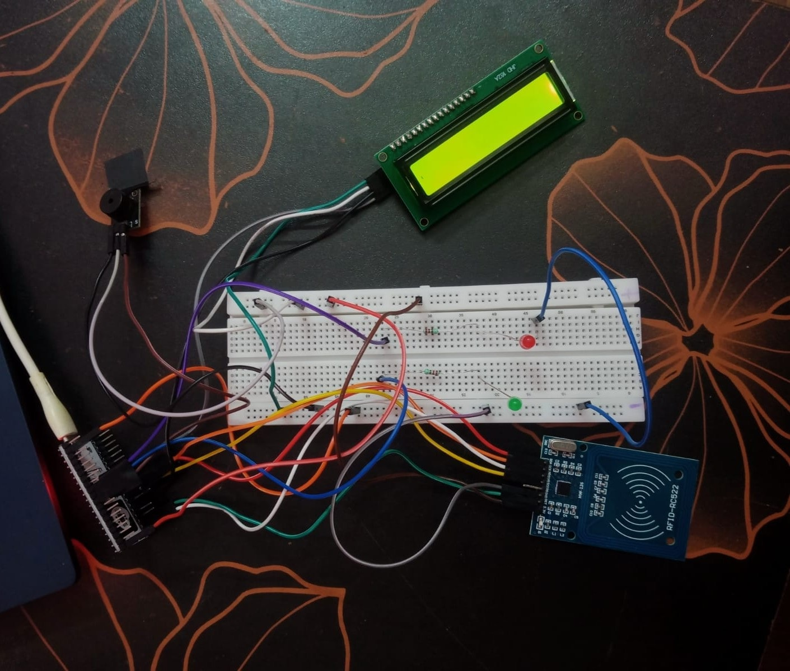

# Smart Attendance System Using RFID

An ESP32-based RFID attendance prototype using an RC522 reader, a 16x2 I2C LCD, two status LEDs, and a buzzer. The system reads an RFID card UID, checks whether it is registered, displays the result, and prevents repeat attendance marks during the same powered session.

## Features

- Reads compatible RFID cards/tags with the RC522 module over SPI.
- Registers a card UID against a student name through the Serial Monitor.
- Stores registered UID/name mappings in ESP32 Preferences, so registrations remain after restart.
- Displays prompts and scan results on a 16x2 I2C LCD.
- Uses a green LED and a short buzzer signal for accepted cards.
- Uses a red LED and error beeps for unregistered cards.
- Detects a second scan of a card already marked during the current power session.
- Prints card UIDs and attendance events to the Serial Monitor.

## Hardware

- ESP32 development board
- RC522/MFRC522 RFID reader and compatible RFID card/tag
- 16x2 LCD with I2C adapter
- Green LED and red LED, each with a 220 ohm current-limiting resistor
- 3-pin buzzer module
- Breadboard, jumper wires, and USB data cable

## Pin connections

| Module signal | ESP32 connection |
|---|---|
| RC522 SDA / SS | GPIO 5 |
| RC522 SCK | GPIO 18 |
| RC522 MOSI | GPIO 23 |
| RC522 MISO | GPIO 19 |
| RC522 RST | GPIO 22 |
| RC522 VCC / GND | 3V3 / GND |
| LCD SDA | GPIO 21 |
| LCD SCL | GPIO 17 |
| LCD I2C address in code | `0x27` (some adapters use `0x3F`) |
| Buzzer signal (`S`) | GPIO 25, after confirming the module pinout |
| Green LED | GPIO 26 through a 220 ohm resistor; cathode to GND |
| Red LED | GPIO 27 through a 220 ohm resistor; cathode to GND |

See [`hardware/Smart_Attendance_Circuit_Pin_Mapping.png`](hardware/Smart_Attendance_Circuit_Pin_Mapping.png) for the pin-mapping diagram.

### Electrical safety

The RC522 uses 3.3V. ESP32 GPIO pins are not 5V tolerant. Verify the LCD I2C pull-up voltage before connecting it directly to the ESP32; if its SDA/SCL lines are pulled up to 5V, use a suitable level shifter or another verified 3.3V-safe arrangement. Confirm the buzzer module's voltage rating and pinout before powering it.

## Software requirements

- Arduino IDE
- ESP32 board support package
- `MFRC522` library
- A compatible `LiquidCrystal_I2C` library that provides `LiquidCrystal_I2C.h`

`SPI`, `Wire`, and `Preferences` are provided by the ESP32/Arduino environment.

## Upload and run

1. Open `Smart_Attendance_ESP32_RFID.ino` in Arduino IDE.
2. Install the required libraries listed above.
3. Select the appropriate ESP32 board (the project was configured for **ESP32 Dev Module**) and the serial port for the board.
4. Upload the sketch.
5. Open Serial Monitor at **115200 baud** and set the line ending to **Newline**.
6. Scan a card/tag. For a new UID, use the printed UID to register a name with the `ADD` command below.

## Serial Monitor commands

| Command | Purpose |
|---|---|
| `HELP` | Displays the command list. |
| `LIST` | Lists registered UID/name pairs. |
| `ADD <UID> <Name>` | Registers a UID or updates the name associated with it. |

Example format (replace this example with the exact UID printed by your reader):

```text
ADD 04:A1:B2:C3 Student One
```

## Working logic

1. On startup, the ESP32 initializes the LCD, SPI bus, RC522, LEDs, buzzer, and serial interface.
2. Registered UID/name mappings are loaded from ESP32 Preferences.
3. The LCD displays a prompt to scan a card.
4. An unregistered UID produces a not-registered message, red LED feedback, and error beeps.
5. A registered UID not yet marked during the current power session produces an attendance confirmation, the student's registered name, green LED feedback, and a success beep.
6. Scanning the same registered card again during that session shows an already-marked message and does not add a second mark.

## Test results

The assembled prototype was functionally tested. The reported checks passed:

- Arduino sketch compilation and upload
- LCD startup and scan prompt
- Registered card recognition and attendance confirmation
- Unregistered card status feedback
- Duplicate scan detection during a powered session
- Green/red LED and buzzer feedback
- Serial Monitor UID and attendance-event output

The photos in [`images/`](images/) document the assembled hardware prototype.

## Current scope and limitations

- The firmware supports up to 30 registered student UID/name pairs.
- Registered student mappings persist in ESP32 Preferences.
- Attendance de-duplication is held in RAM and resets after power is removed or the board restarts.
- The printed `uptime_ms` value is elapsed time since boot, not calendar date/time.
- This version does not save a persistent attendance history to an SD card, database, or cloud service. An RTC or network time source and persistent log storage can be added in a future revision.
- An RFID UID identifies a tag, not the person carrying it; card sharing is not prevented by UID checking alone.

## Prototype photos







## Repository contents

```text
.
├── README.md
├── Smart_Attendance_ESP32_RFID.ino
├── hardware/
│   └── Smart_Attendance_Circuit_Pin_Mapping.png
├── images/
│   ├── prototype-view-1.jpg
│   ├── prototype-view-2.jpg
│   └── prototype-view-3.jpg
└── docs/
    ├── Smart_Attendance_Project_Report.docx
    ├── Smart_Attendance_Project_Report.pdf
    ├── Smart_Attendance_Project_Presentation.pptx
    └── Smart_Attendance_Project_Presentation.pdf
```

## Privacy note

Do not commit real student names, real card UIDs, private attendance records, Wi-Fi credentials, or other personal data. Use test values when demonstrating the project.
